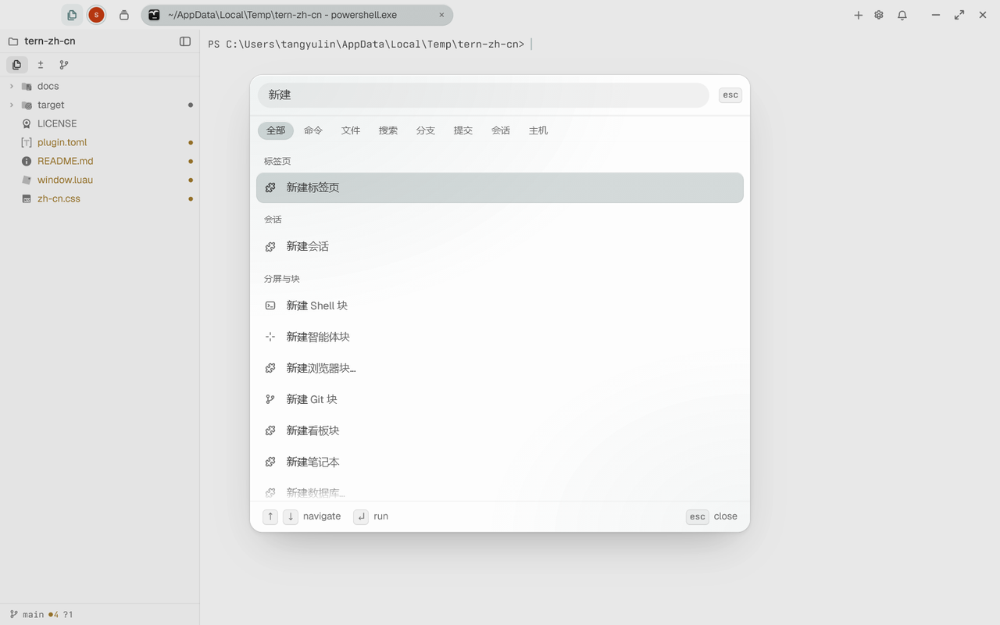

# tern-zh-cn

Tern 终端的简体中文汉化插件。

[Tern](https://stencil.so/tern) 是 Stencil 的 Rust 原生终端，目前官方没有 i18n 框架。本插件用官方插件机制做"半汉化"：

- **中文命令面板**：以中文标题注册 60+ 个常用内置命令的包装，在命令面板（`Ctrl+Shift+P`）里直接打中文搜索，如"新建标签页""向右拆分""设置"。
- **静态文字替换**：用全局 CSS 把命令面板作用域页签（全部/命令/文件/搜索/分支/提交/会话/主机）和标签栏按钮文字换成中文。



## 安装

```sh
tern plugin install github.com/maicent/tern-zh-cn
```

或在 Tern 的 Preferences › Plugins 里填同样的 GitHub 地址。

## 不能翻译的部分（原理限制）

- 内置命令的英文原行无法改名或隐藏（palette 行没有可选择器属性），但中文行排在同一列表里，搜索中文即可。
- 动态文本（toast 通知、错误消息、对话框内容、帮助文本）是运行时生成的字符串，插件没有文本拦截钩子。
- 工具提示（tooltip）文字来自 HTML `title` 属性，CSS 改不了。

## 实现方式

- `window.luau`：`tern.command` 注册中文包装命令，`run` 里调用对应内置命令（`cx:command(...)`），不改行为。
- `zh-cn.css`：`font-size: 0` 隐藏原文 + `::before { content: "中文" }` 注入翻译。Tern 的 CSS 引擎支持 `content` 与伪元素，详见 [Supported CSS](https://docs.stencil.so/tern/styles/css.html)。

## 维护说明

当前对齐 **Tern 0.9.18**（Windows 实测）。升级 Tern 后若界面文字"复活"或中文标签错位，对照新版本的 DOM 调整 `zh-cn.css`；若某个中文行点了报
`Plugin 中文汉化: command ... failed ... unknown command`，说明该内置命令没了，改 `window.luau` 里的 id。排查工具：

```sh
tern serve --control 7801                      # headless 窗口（不加载已装插件：用 ctl css 试样式）
tern ctl --control 7801 palette                # 打开命令面板
tern ctl --control 7801 css zhcn ./zh-cn.css   # 现场注入样式，不必重装
tern ctl --control 7801 dump                   # 每个元素的路径、位置与计算样式（含 fontSize）
tern ctl --control 7801 shot pal               # 截图，肉眼确认
```

测已装插件的 `window.luau` 要用真窗口：`tern --control 7802` 起一个窗口，再
`tern ctl --control 7802 plugins run plugin.zh-cn.<id>` 跑某个包装命令，失败会弹 toast；
`tern ctl --control 7802 tree .toast` 读 toast 文字。

几个已经踩过的坑（0.8 → 0.9.18）：

- 作用域页签从 7 个变成 8 个：`All, Commands, Files, Search, Branches, Commits, Sessions, Hosts`。
  会话/主机固定是最后两个，所以用 `:nth-last-of-type(2)` / `:nth-last-of-type(1)`，
  不要用固定序号，否则非 Git 目录下（分支/提交隐藏）会串位。
- `status_bar` 命令在 0.9.17 随状态栏→控件栏改版被移除，`cx:command("status_bar")` 报
  `unknown command`；现在包装的是 `edit_widgets`。
- 状态栏相关 CSS 选择器从 `#statusline .sl-plugin` 变成 `#widgetbar .wg-seg`。

## License

MIT
