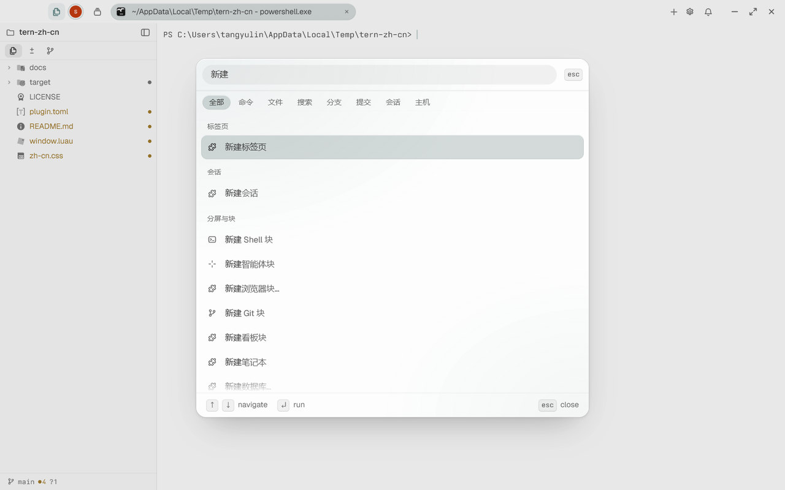

# tern-zh-cn

Tern 终端的简体中文汉化插件。

[Tern](https://stencil.so/tern) 是 Stencil 的 Rust 原生终端，目前官方没有 i18n 框架。本插件用官方插件机制做"半汉化"：

- **中文命令面板**：以中文标题注册 250 条内置命令的包装，在命令面板（`Ctrl+Shift+P`）里直接打中文搜索，如"新建标签页""向右拆分""设置"。
- **设置面板全汉化**：14 个设置页（通用 / 智能体 / 外观 / 终端 / 透镜 / 数据库 / 笔记本 / Carly / Git / 插件 / 会话 / 主机 / 高级）的标题与说明行。
- **键盘页全汉化**：722 行快捷键命令名 + 722 行说明，规则按行号精确对应。
- **浮层汉化**：命令面板作用域页签、标签栏按钮、块右键菜单、命令面板 Hosts 页、添加远程主机对话框。



## 安装

```sh
tern plugin install github.com/maicent/tern-zh-cn
```

或在 Tern 的 Preferences › Plugins 里填同样的 GitHub 地址。

### 键盘页需要单独安装

Tern 限制**单个插件**的 CSS 合计不超过 256 KiB。键盘页（722 行标题 + 722 行说明）单文件就有 202 KiB，塞进主插件会超限并导致整个插件加载失败。

所以仓库里有两个插件包，第二个要单独装：

```sh
tern plugin install github.com/maicent/tern-zh-cn/keys
```

或者在 Preferences › Plugins 里填 `github.com/maicent/tern-zh-cn/keys`。装完 `tern plugin list` 应该看到 `zh-cn` 和 `zh-cn-keys` 两条。

如果第二条显示 `disabled`，reload 一次即可：

```sh
tern plugin reload zh-cn-keys
```

**从本地目录安装会出问题。** `tern plugin install` 处理本地目录时会复制整个目录树，仓库里的 `keys/` 会跟着进到 `plugins/zh-cn/keys/`，和独立的 `zh-cn-keys` 撞 id。Tern 遇到重复 id 用先扫到的那份，也就是嵌套副本，于是改动永远不生效、版本号也停在旧的那份。

```sh
# 会连 keys/ 一起复制进去 —— 别这么装本地目录
tern plugin install /path/to/tern-zh-cn

# 从 git URL 装主包不会带 keys/（只复制包需要的文件）
tern plugin install github.com/maicent/tern-zh-cn
tern plugin install github.com/maicent/tern-zh-cn/keys
```

从本地目录装过之后，检查有没有嵌套副本：

```sh
ls ~/AppData/Roaming/Tern/plugins/zh-cn/keys    # 不该存在；有就删掉再 reload
```

## 不能翻译的部分（原理限制）

- **内置命令的英文原行**无法改名或隐藏（palette 行没有可选择的属性，且搜索时列表会重排）。但中文行排在同一列表里，搜中文即可。
- **块菜单（shell / 画布块的 `⋮` 菜单）**：菜单关闭时元素不在 DOM 里，插件既拿不到文本也无法验证选择器，因此未做。
- **动态文本**（toast 通知、错误消息、帮助文本）是运行时生成的字符串，插件没有文本拦截钩子。
- **工具提示**（tooltip）文字来自 HTML `title` 属性，CSS 改不了。

## 实现方式

- `window.luau`：`tern.command` 注册中文包装命令，`run` 里调用对应内置命令（`cx:command(...)`），不改行为。
- `*.css`：`font-size: 0` 隐藏原文 + `::before { content: "中文" }` 注入翻译。Tern 的 CSS 引擎支持 `content` 与伪元素，详见 [Supported CSS](https://docs.stencil.so/tern/styles/css.html)。

文件分工：

| 文件 | 内容 | 大小 |
|---|---|---|
| `zh-cn.css` | 命令面板页签、标签栏按钮 | 4 KB |
| `settings-zh.css` | 设置面板 14 页 + 浮层 + 菜单 | 164 KB |
| `keys/keyboard.css` | 键盘页 722 行标题与说明 | 202 KB |

设置页用 `:has()` 判断当前在哪一页，因为 14 页共用同一套 DOM 结构——`.pf-sec:nth-of-type(2)` 在 General 页和 Git 页指的是不同内容。

## 维护说明

选择器基于 Tern 0.9.x 的内部 class（`tn-*`、`pf-*`、`sf-*`），升级 Tern 后若界面文字"复活"，需要对照新版本的 DOM 调整。排查工具：

```sh
tern ctl dump '.pf-doc .pf-row>.pf-lbl>.t'   # 设置页标题
tern ctl dump '.pf-doc .pf-row>.pf-lbl>.h'   # 设置页说明
tern ctl tree '.pf-doc .pf-row>.pf-lbl>.t'   # 只读可见的，带文本
tern ctl a11y                                # 无障碍树，带 Label 文本
```

`dump` 返回元素的全局坐标（含滚动区外的），`tree` 只返回视口内的。解析长列表时用 `dump` 拿位置、`tree` 拿文本，再按顺序配对。

`keys/keyboard.css` 是用脚本生成的：`(section, nth-child)` 来自 `dump` 的坐标排序，标题来自一次滚动到位后的 `tree`。Tern 升级后重跑生成脚本比手改快。

## License

MIT
